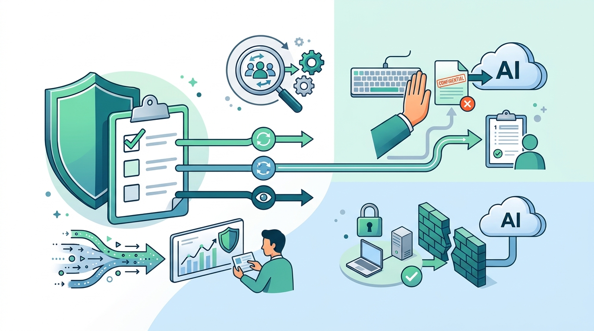

## はじめに

AIのアプリで「学習に使わない」設定をオンにしたから大丈夫。会社でチームプランに入っているから、情報は社内で収まっているはず。そう考えたことはありませんか。

私自身、秘密情報がログに出てしまい、パスワードを変えることになりました。そのとき、あらためて「自分の手元で、何が、どこへ出ていく可能性があるのか」を整理し直したくなりました。

:::

## 対象者

- Claude Code などのAIコーディングツールを、日常的に使っている方
- 「学習されない設定にしているから大丈夫」と考えている方
- 会社のチームプランに入っているから、情報は社内に収まっていると思っている方

## 「学習されない」と「情報が出ていかない」は別の話

### 学習オフでも変わらないこと

学習されない設定にすると、入力した内容がモデルの学習に使われなくなります。ただ、これは「情報が相手のサーバーに届かなくなる」という意味ではありません。

Claude Code の[公式ドキュメント](https://code.claude.com/docs/en/data-usage)から、設定やプランとの関係を整理してみます。

| 項目 | 公式ドキュメントの記載 | 学習の設定との関係 |
| --- | --- | --- |
| 送信 | プロンプトとモデルの出力はすべて、ネットワーク経由で送信される（TLSで暗号化） | 関係しない |
| 学習 | 個人向けプラン（Free、Pro、Maxなど）は設定がオンのときに学習に使う。Team、Enterprise、APIは、商用条件のもとでは学習に使わない | ここだけが設定やプランで変わる |
| サーバー上の保持 | 個人向けは学習オンで5年、オフで30日。商用の標準は30日 | 期間は変わるが、ゼロにはならない |
| 保存しない設定（ゼロデータリテンション、ZDR） | 対象になった組織だけが、提供元の確認を経て個別に有効にできる。標準のEnterpriseプランには含まれない | 組織ごとの手続きが必要 |
| 手元のセッション記録 | `~/.claude/projects/` に平文で保存され、既定では30日残る | 関係しない |

平たく言えば、学習の設定で変わるのは「その情報を何に使うか」と「サーバーに置かれる期間」です。送った時点で、相手のサーバーに情報が届くことは変わりません。

:::message
誤解のないようにお伝えすると、これは「AIを使わないほうがいい」という話ではありません。
大切なのは、何がどこへ届くのかを知ったうえで、入れる情報を自分で選べるようにしておくことです。
:::

### 「チームプランだから中に収まる」と言い切れない理由

チームプランや法人向けのプランで学習されないのは、とても大切な点です。ただ、それは「契約上、学習には使わない」という約束であって、情報が自社の中だけに留まるという意味ではありません。

- 情報はベンダーのクラウドに送られ、標準では30日保持される
- 保存しない設定（ZDR）は、対象の組織だけが別途有効にする
- MCPサーバー（AIに外部のツールやデータをつなぐ仕組み）などの連携先に渡した内容は、その連携先の運営者にも届く
- 手元のPCにも、セッションの記録が平文で残る

つまり、「学習されない設定」は必要な条件の1つではあっても、安全であることの証明ではない、と考えます。

## 手元で見直したい3つのこと

### 1. 秘密情報の実値と本番のデータを、AIに触れさせない

送った内容はサーバーと手元に残るので、そもそも渡さないのがいちばん確実です。次の点を見直してみてください。

- 手元の `.env` や設定ファイルに、本番の秘密情報が平文で入っていないか
- AIに作業を頼むとき、秘密の値ではなく、キーの名前だけを渡せば足りないか（`.env.example` に名前を書き、値は人が入れる、など）
- AIに接続させるデータベースは、開発用や検証用にして、本番とは別にしているか。接続するユーザーは読み取り専用にして、見せる列も絞れているか
- 本番の接続文字列を、手元の `.env` やMCPの設定に入れていないか

### 2. 使うサービスのプランと保持と連携先を確認する

どのサービスに、どのプランで、どんな情報を入れてよいのかは、個人の判断ではなく、チームで決めておくと安心です。次の3つを、一度表にしてみるのをおすすめします。

- 個人向けか、商用プランか。学習に使われるか
- サーバー上の保持期間と、保存しない設定（ZDR）が必要か
- 連携先（MCPサーバーなど）の運営者。AIの提供元とは別の会社の場合がある

「このプランでは個人データを入れない」と決めるだけで、判断がずいぶん楽になると思います。

### 3. 禁止は「文章」ではなく「仕組み」で止める

CLAUDE.md に「`.env` は読まないでください」と書いておくのは、とても大切です。ただ、公式ドキュメントでも、CLAUDE.md への記載は、AIの試みを方向づけるものであって、境界を強制するものではないと説明されています。平たく言えば、お願いはできても、止める力はありません。

機械で止められるものは、仕組みで止めるのがおすすめです。

- `permissions.deny`（設定ファイルに書く禁止ルール）は、`Read(.env)` や `cat` などの読み取りを止められます。ただし、`grep -r pattern .` のようにファイルを名指ししない読み取りや、PythonやNodeのスクリプトが自分でファイルを開く場合は、対象外です
- フック（PreToolUse）は、AIが操作を実行する直前に、自分で書いた判定プログラムを走らせて、止めるかどうかを決められます。ただし、止められるのは書いた判定の範囲だけです
- サンドボックスは、OSの段階で、プロセス全体が触れるファイルやネットワークの範囲を区切ります

私は、複数のプロジェクトで同じ守りを効かせたくて、このうち `permissions.deny` とフックを共通の設定として用意しています。ポイントは、`.env.example` のような見本のファイルは読めるように残していることです。広く止めすぎると、誤検知が増えて、設定が形だけになってしまうからです。

どの仕組みにも、止められない経路はあります。だからこそ、1で書いた、そもそも手元に実値を置かない、本番に接続させない、という入口の対策と組み合わせることが大切だと考えています。

## まとめ - 3つを並べて見る -

| 対策 | 対応 | 何をするか |
| --- | --- | --- |
| 1. 実値と本番データを触れさせない | 手元の `.env` に本番の値が入っていないか確かめる | AIに渡る秘密と個人情報の量 |
| 2. プランと保持と連携先の確認 | 使っているプランと保持期間を表にする | 想定していない場所に残る情報 |
| 3. 仕組みで止める | `permissions.deny` とフックを1つ入れる | 「書いてあるのに守られない」状態 |

## おわりに

「学習されない設定をオンにしたから大丈夫」と考えるのは、とても自然なことだと思います。設定の名前だけを見ると、安心してしまいそうになります。
ただ、秘密情報がログに出てしまうことで、情報が相手のサーバーに届き、一定の期間そこに残ること。手元にも、記録が平文で残ること。そして、禁止を文章で書くだけでは、止める力にならないこと。どれも、知っているだけで、判断が少し変わってくると思います。
本記事が、ご自身の秘密情報の取り扱いを見直してみるきっかけになれば幸いです。

---

## 株式会社ONE WEDGE

【ITエンジニアに、IT業界に貢献する企業】
株式会社ONE WEDGEは、Webシステム開発・SES・AI/DX支援を行うIT企業です。生成AIを活用した業務効率化や次世代システム開発にも注力しており、企業の課題解決だけでなく、エンジニア一人ひとりの成長にも本気で向き合っています。また、技術は「一人で学ぶもの」ではなく「仲間と成長するもの」と考え、社内外でのコミュニティづくりにも力を入れています。

https://onewedge.co.jp/
