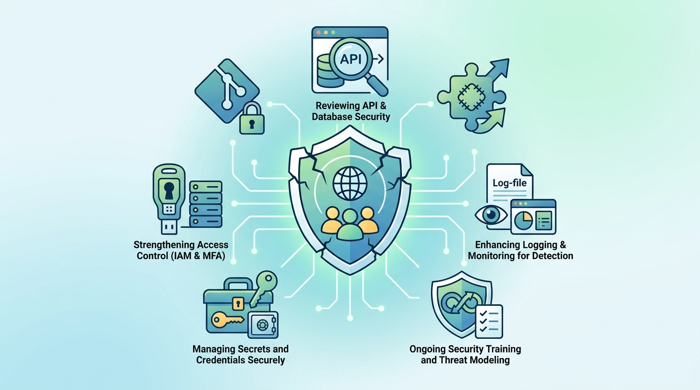

## はじめに

2026年10月から11月にかけて、GMOインターネットグループで、不正アクセスや情報漏えいの公表が相次ぎました。アンケートサイト「infoQ」で会員の個人情報が外部に持ち出され、「お名前.com デスクトップクラウド」ではサーバーの全プランが停止し、11月2日にはID管理サービスで、設定ミスにより約4万5000人分の顧客情報が外部から閲覧できる状態だったことが公表されました。

GMOグループに限らず、ここ数か月は、さまざまな企業から同じような公表が続いています。

前編では、サービスを使う側の目線で、私たちにできることをまとめました。

[https://zenn.dev/ykbone/articles/202610-security-data-breach-users](https://zenn.dev/ykbone/articles/202610-security-data-breach-users)

後編となる本記事では、サービスを開発する・運用する側の目線に立って、自分の現場で何を見直せばいいのかを、7つに絞って一緒に整理していきます。

## 対象者

- Webサービスや社内システムの開発・運用に関わっている方
- サポートが終了したフレームワークやライブラリを、まだ本番で動かしている方
- 依存パッケージの更新を「時間ができたらやる」にしている方
- 会員情報や本人確認書類などの個人情報を預かるシステムを担当している方

## 何が分かっていて、何が分かっていないのか

### 公式に発表されていること

まず、GMOインターネットグループから公表されている内容のうち、確認できたものを整理します。


| 公表日             | サービス                                                                                      | 公表されている内容                                                             |
| --------------- | ----------------------------------------------------------------------------------------- | --------------------------------------------------------------------- |
| 2026年10月5日（第1報） | GMOリサーチ&amp;AI「infoQ」（[報道](https://scan.netsecurity.ne.jp/article/2026/10/19/56497.html)） | 不正アクセスにより会員の個人情報が外部に持ち出された。10月14日の第2報で、持ち出された件数は89万4,082件と公表          |
| 2026年10月21日     | お名前.com デスクトップクラウド（[第1報](https://www.onamae.com/news/article/11584)）                      | 10月20日に第三者による不正なプログラムの設置を確認し、全プランのサーバーを順次停止。影響の可能性があるサーバーは26,739件     |
| 2026年11月2日      | GMOグローバルサイン「GMOトラスト・ログイン」（[報道](https://www.jiji.com/jc/article?k=2026110200432&g=eco)）    | 設定ミスにより、約4万5000人分（2,492社）の顧客情報が約9年間、外部から閲覧できる状態だった。パスワードや決済情報は含まれていない |


:::message alert  
本記事の執筆時点（2026年11月3日）での情報です。

以降の内容は、特定の事案の原因を断定するものではなく、公表されている内容から、自分の現場で見直したい点を考えたものです。  
:::

これらの内容は、特別に新しい攻撃手法の話ではなく、「分かっていた課題への対応」や「設定の見落とし」といった、私たちの現場にも起こりうる話だと感じました。

### 3週間で21件、原因を並べてみると

GMOグループだけが特別なわけではありません。ITmedia エンタープライズのまとめ記事によると、2026年9月16日から10月5日までの約3週間で、21の企業・組織が情報漏えい（そのおそれを含む）を公表しています。

そこに挙げられている各社の公表内容を、原因の種類ごとに私なりに並べ直してみました。


| 原因の種類         | 公表されている内容の例                                  |
| ------------- | -------------------------------------------- |
| 脆弱性の悪用        | 画像アップロードサーバーの脆弱性、ログイン機能の脆弱性、使用しているソフトウェアの脆弱性 |
| 設定・仕様の不備      | CMSの設定不備、ダウンロード機能の条件設定の不備、キャッシュ設定の変更、機能の仕様不備 |
| 委託先・周辺システム    | 委託先のサーバーへの不正アクセス、配信停止中のメールアドレスを保管していたサーバー    |
| アカウントへの不正ログイン | クラウドサービスのアカウントへの不正ログイン                       |


表を見ると、特別に新しい攻撃手法が並んでいるわけではないことが分かります。更新されていなかった、設定が想定と違っていた、周辺のシステムまで目が届いていなかった。どれも、そのときは合理的な判断の結果だったはずですし、私たちの現場にも思い当たるものが1つくらいはあるのではないでしょうか。

### 見落としを放置できる時間は短くなっている

以前の記事で、AIによって攻撃コードを作る手間が大きく下がっているという話を紹介しました。

[https://zenn.dev/ykbone/articles/202610-security-hacking-openai](https://zenn.dev/ykbone/articles/202610-security-hacking-openai)

これまでは、古いシステムに脆弱性が残っていても、それを見つけて実際に使える攻撃に仕立てるには、専門知識と長い時間が必要でした。その「手間」が、知らないうちに私たちを守ってくれていた面があります。

その手間が小さくなっているのだとすると、「古いけれど、今まで何も起きていない」ということは、以前ほど安心材料にはならないと思っておいたほうがよさそうです。

## エンジニアが今日から見直したい対策7選

ここからが本題です。大がかりなものもありますが、どれも最初の一歩は小さく始められるようにまとめました。

順番は、優先度が高いものから、同じ優先度の中では手を付けやすいものから並べています。

### 1. 依存関係を棚卸しして、EOLを把握する

何が動いているのかを知らなければ、更新のしようがありません。まずは、フレームワーク、言語のランタイム、OS、ミドルウェアのバージョンを書き出すところから始めます。

```bash
# PHP / Laravel
php -v
composer show --direct

# Node.js
node -v
npm ls --depth=0

# Java（Maven）
mvn dependency:tree
```

サポート期限は、[endoflife.date](https://endoflife.date/) で製品ごとにまとめて確認できます。APIも用意されているので、定期的なチェックに組み込むこともできます。

```bash
# Laravel の各バージョンのサポート期限を確認
curl -s https://endoflife.date/api/laravel.json | jq '.[0:3]'
```

書き出した一覧に「サポート終了日」の列を1つ足すだけでも、どこから手を付けるべきかが見えてくると思います。

2026年10月9日にIPAが公表した[注意喚起](https://www.ipa.go.jp/security/security-alert/2026/alert20261009.html)でも、最初の一歩として、外部に公開しているアプリケーションやサービスを洗い出すことが挙げられています。

:::message
見落としやすいのは、フロントエンドに残っている古いJavaScriptライブラリや、管理画面だけで使っているプラグインです。ブラウザの開発者ツールで、実際に読み込まれているファイルの一覧を確認すると、把握していなかったものが見つかることがあります。
:::

### 2. 脆弱性情報が届き、すぐ更新できる仕組みを作る

「脆弱性が見つかったら更新する」を人の記憶や善意に頼ると、忙しい時期にどうしても抜けてしまいます。知らせが自動で届き、更新のプルリクエストまで自動で作られる状態にしておくと安心です。

GitHubを使っているなら、[Dependabot](https://docs.github.com/ja/code-security/dependabot) の設定ファイルを1つ置くだけで始められます。

```yaml
# .github/dependabot.yml
version: 2
updates:
  - package-ecosystem: "composer"
    directory: "/"
    schedule:
      interval: "weekly"
  - package-ecosystem: "npm"
    directory: "/"
    schedule:
      interval: "weekly"
```

手元やCIでは、各パッケージマネージャーの監査コマンド（[composer audit](https://getcomposer.org/doc/03-cli.md#audit)、[npm audit](https://docs.npmjs.com/cli/commands/npm-audit)）が使えます。

```bash
composer audit
npm audit
```

あわせて、次のような情報源を、チームのチャットに流れるようにしておくのもおすすめです。

- [JVN iPedia](https://jvndb.jvn.jp/)（日本語で読める脆弱性対策情報データベース）
- CISA の [Known Exploited Vulnerabilities Catalog](https://www.cisa.gov/known-exploited-vulnerabilities-catalog)（実際に悪用が確認された脆弱性の一覧）
- 使っているフレームワークやミドルウェアの、公式のセキュリティアドバイザリ

:::message
CVEが付いていない修正が、配布パッケージに届いていないこともあります。この点は「[4つの攻撃ステップと現場で確かめたいこと](https://zenn.dev/ykbone/articles/202610-security-openai-chain)」で詳しく紹介しました。外から来たデータを最初に解析するライブラリだけでも、上流のリリースノートを定期的に確認するのがおすすめです。
:::

### 3. 保管する個人情報と保管期間を、必要最小限にする

情報漏えいの公表を読むとき、いちばん気になるのは、どんな情報が、どれくらいの期間分、含まれていたのかという点です。グローバルサインの件では、設定ミスが約9年間続いていたとされています。長く持っているデータほど、見直されないまま外から見える状態になっている期間も、長くなりやすいのかもしれません。

法令で保管が求められる情報があるのは確かです。一方で、IPAの[注意喚起](https://www.ipa.go.jp/security/security-alert/2026/alert20261009.html)でも、不要な情報は持たないという基本に立って、保有している情報を必要最小限にする再点検が求められています。そのうえで、次の点を、自分のシステムで確認してみましょう。

- 保管が必要なのは、どの項目か。本人確認書類の画像そのものまで必要か、それとも「確認済み」という記録だけで足りるか
- 入会が完了しなかった申し込みのデータは、いつ消えるのか
- 退会した方のデータは、現役の会員と同じデータベース、同じ権限で読める場所に置かれていないか
- 保管期間を過ぎたデータを消す処理は、実際に動いているか

本人確認書類の画像のように、流出したときの影響が大きい情報は、会員情報とは別の保管場所に置き、Webアプリケーションからは直接読めないようにしておくだけでも、流出したときの範囲を小さくできます。

平たく言えば、「集めるときに、消すときのことまで決めておく」ということだと思います。

### 4. レガシーシステムは「延命」と「更新」を分けて計画する

サポートが終了したフレームワークには、新しい脆弱性が見つかっても修正が提供されません。国家サイバー統括室が10月9日に出した注意喚起でも、ソフトウェアの速やかな更新とあわせて、サポートが終了した製品の使用をやめることが挙げられていると[報じられています](https://internet.watch.impress.co.jp/docs/news/2147162.html)。ただ、だからといって明日すぐに作り直せるわけでもないですよね。

そこで、すぐにできる延命策と、時間をかけて進める更新を、分けて考えるのがよいと思います。


| 種類  | 内容                                   | 位置づけ   |
| --- | ------------------------------------ | ------ |
| 延命  | WAFの導入、管理画面や不要なエンドポイントの公開範囲を絞る、監視の強化 | 一時的な対策 |
| 更新  | サポートのあるフレームワークへの移行、機能単位での段階的な置き換え    | 根本的な対応 |


WAFは頼りになりますが、アプリケーションそのものの穴をふさぐものではありません。延命策を入れたことで安心してしまい、更新の計画が止まってしまうのが、いちばん避けたい状態だと思います。

一度にすべてを作り直すのが難しい場合は、新しいシステムを並行して用意し、機能を少しずつ移していく方法（[ストラングラーフィグパターン](https://martinfowler.com/bliki/StranglerFigApplication.html)）もあります。個人情報を扱う画面やAPIから先に移す、という順番の決め方もできます。

そして、移行にかかる費用を説明するときには、「放置した場合に起きうること」を並べて示すと、判断する側にも伝わりやすくなります。今回の一連の公表は、そのための材料にもなるのではないでしょうか。

### 5. 一度に大量のデータを取得できないようにする

数十万件、数万台といった規模の公表を見るたびに考えさせられるのは、侵入を完全に防ぐことは難しくても、一度に取り出せる量を抑えることはできるのではないか、という点です。

- 一覧を返すAPIや検索機能に、取得件数の上限とレート制限を設ける
- 画面でボタンを隠すだけでなく、サーバー側でも、リクエストごとに「その人がそのデータを見てよいか」を確認する
- アプリケーションがデータベースに接続するユーザーの権限を、必要なテーブルと操作だけに絞る
- 通常ではありえない件数の読み出しがあったときに、アラートが上がるようにする

上の2つは、[OWASP API Security Top 10](https://owasp.org/API-Security/editions/2023/en/0x11-t10/) でも、リソース消費の制限の不備や、オブジェクト単位の認可の不備として、上位に挙げられている項目です。

入口を守る対策に加えて、入られたあとに被害が広がりにくい作りにしておく。この2つを分けて考えるだけでも、見直す場所がはっきりしてくると思います。

### 6. パスワードの保管方式を、いまの基準で見直す

情報漏えいの公表では、パスワードについて「復元できない形式で保管していた」と説明されることがあります。ただ、具体的な方式まで公表されることは多くありません。ここからは特定の事案とは切り離した、一般的な話です。

「ハッシュ化している」といっても、その中身には大きな幅があります。MD5やSHA-1のような高速なハッシュ関数を、ソルトなしでそのまま使っている場合、流出したあとに元のパスワードを推測されやすくなります。長く動いているシステムほど、導入当時の方式がそのまま残っていることがあるので、一度確かめておくと安心です。

OWASP の [Password Storage Cheat Sheet](https://cheatsheetseries.owasp.org/cheatsheets/Password_Storage_Cheat_Sheet.html) では、Argon2id が第一の選択肢として挙げられています。それが使えない場合は scrypt、どちらも使えない既存のシステムでは bcrypt、という順番です。PHPであれば、標準の関数（[password_hash](https://www.php.net/manual/ja/function.password-hash.php)、[password_needs_rehash](https://www.php.net/manual/ja/function.password-needs-rehash.php)）で対応できます。

```php
// 保存するとき
$hash = password_hash($password, PASSWORD_ARGON2ID);

// ログインのとき
if (password_verify($password, $hash)) {
    // 古い方式や古いパラメーターで保存されていたら、新しい方式で保存し直す
    if (password_needs_rehash($hash, PASSWORD_ARGON2ID)) {
        $newHash = password_hash($password, PASSWORD_ARGON2ID);
        // $newHash をデータベースに保存する
    }
}
```

古い方式から移行する場合は、このように、ログインに成功したタイミングで新しい方式に保存し直していく方法がよく使われます。全員に一斉にパスワードを再設定してもらわなくても、少しずつ移行を進められます。

### 7. 検知と初動を、起きる前に決めておく

たとえばデスクトップクラウドの件では、不正なプログラムの設置を確認した翌日の午前4時以降に、全プランのサーバーを順次停止すると公表されました。また、infoQ では会員からの問い合わせが、グローバルサインの件では外部の専門家の指摘が、発覚のきっかけとされています。気づいてから止めるまでの時間も、そもそも気づけるかどうかも、事前の準備に大きく左右されます。

- アクセスログや認証ログを、改ざんされにくい場所に、必要な期間だけ保管しているか
- 異常に気づいたとき、誰が、どのシステムを止める判断をしてよいかが決まっているか
- 連絡先（社内、委託先、利用しているクラウドやサービスの窓口）が、すぐに分かる場所にまとまっているか

また、個人情報保護法では、不正アクセスによる漏えいなどが起きた場合、個人情報保護委員会への報告と本人への通知が義務になっています。報告は、事態を知ってから概ね3〜5日以内の速報と、30日以内（不正な目的によるおそれがある場合は60日以内）の確報の2段階です。対象となる事態や様式は、個人情報保護委員会の[漏えい等の対応とお役立ち資料](https://www.ppc.go.jp/personalinfo/legal/leakAction/)にまとまっています。

この期限を、起きてから初めて調べるのと、あらかじめ手順書に書いてあるのとでは、当日の落ち着き方がまったく違ってくると思います。


:::message


防御の側でもAIを使える場面は増えています。コードの静的解析（SAST）や、動いているアプリケーションへの動的な検査（DAST）をCIに組み込み、定期的な脆弱性診断の「合間」を埋めるようにしておくと、見落としに気づけるタイミングが早くなります。


:::


## まとめ - 7つを並べて見る -


| 対策                       | 優先度 | 難易度 | 最初の一歩                 | 何を小さくするか         |
| ------------------------ | --- | --- | --------------------- | ---------------- |
| 1. 依存関係の棚卸しとEOLの把握       | 高   | ★☆☆ | バージョン一覧にサポート終了日の列を足す  | 知らないまま放置している範囲   |
| 2. 脆弱性情報と更新の仕組み化         | 高   | ★★☆ | Dependabot の設定ファイルを置く | 修正が出てから適用するまでの時間 |
| 3. 保管する個人情報と保管期間を最小限にする  | 高   | ★★☆ | 保管期間と削除処理を確かめる        | 流出する情報の量と種類      |
| 4. レガシーの延命と更新を分ける        | 高   | ★★★ | 延命策と更新計画を別の行に書く       | 修正が提供されない期間      |
| 5. 一度に大量のデータを取得できないようにする | 中   | ★★☆ | 一覧APIに上限を設ける          | 一度に流出する件数        |
| 6. パスワード保管方式の見直し         | 中   | ★★☆ | 現在のハッシュ方式を確かめる        | 流出後に解読されるおそれ     |
| 7. 検知と初動の準備              | 中   | ★★☆ | 連絡先と判断者を1枚にまとめる       | 気づいてから止めるまでの時間   |


優先度と難易度は、私なりの目安です。難易度は、★が多いほど時間や調整が必要なものとして付けました。4のレガシーシステムの更新は、いちばん時間がかかりますが、後回しにするほど重くなるので、優先度は高にしています。扱っている情報やシステムの状況によって変わるので、ご自身の現場に合わせて読み替えてください。


## おわりに

私自身、いくつかの会社から「個人情報が流出しました」というお詫びのメールを受け取りました。利用者として受け取ったときは、正直なところ、少しがっかりした気持ちになりました。

ただ、今回あらためて各社の公表内容を読んでいくうちに、その気持ちは「自分の現場は大丈夫だろうか」という問いに変わっていきました。更新を後回しにしているライブラリや、いつ消えるのか把握していないデータは、探せば私の手元にもありそうです。お詫びのメールを送る側になる可能性は、誰にでもあるのだと感じました。

レガシーなシステムを動かし続けてきた判断は、その時々では合理的だったはずです。だからこそ、誰かを責めるのではなく、状況が変わったいま、もう一度見直してみることが大切なのだと思います。

本記事が、ご自身の現場のシステムを見直すきっかけになれば幸いです。

---

## 株式会社ONE WEDGE

【ITエンジニアに、IT業界に貢献する企業】
株式会社ONE WEDGEは、Webシステム開発・SES・AI/DX支援を行うIT企業です。生成AIを活用した業務効率化や次世代システム開発にも注力しており、企業の課題解決だけでなく、エンジニア一人ひとりの成長にも本気で向き合っています。また、技術は「一人で学ぶもの」ではなく「仲間と成長するもの」と考え、社内外でのコミュニティづくりにも力を入れています。

[https://onewedge.co.jp/](https://onewedge.co.jp/)